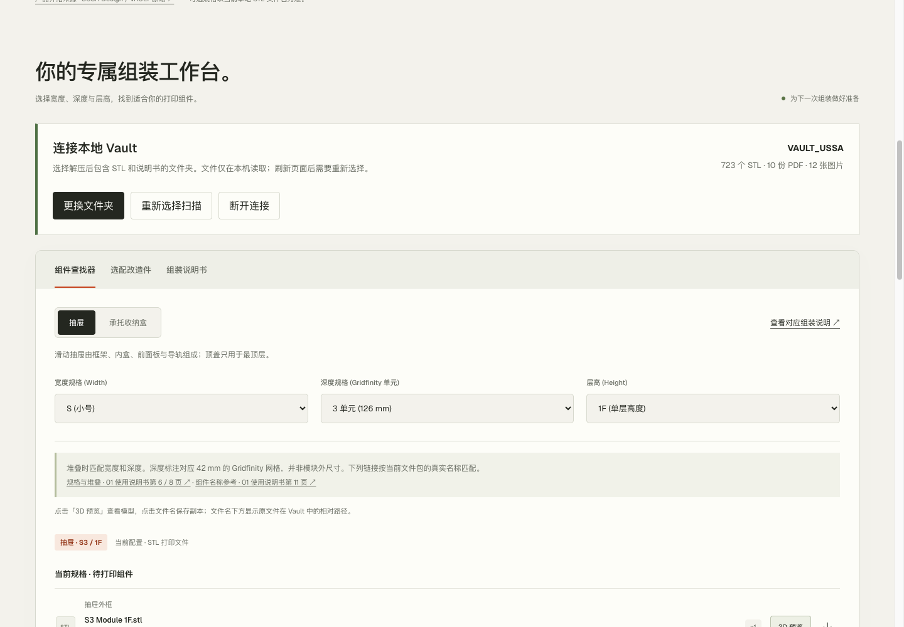
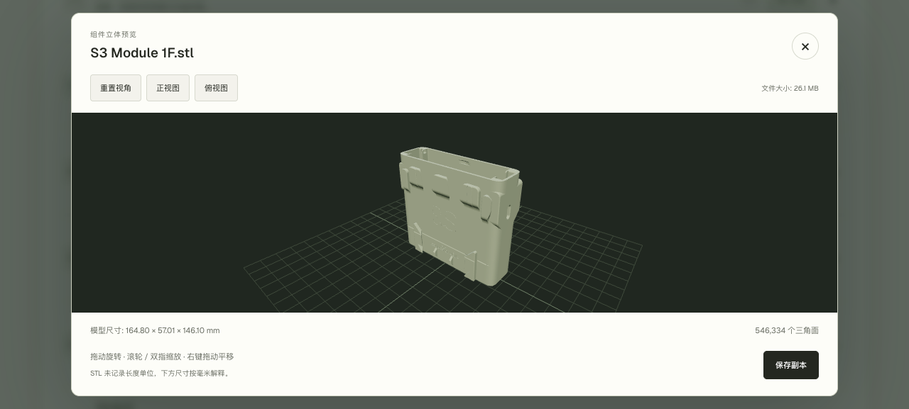
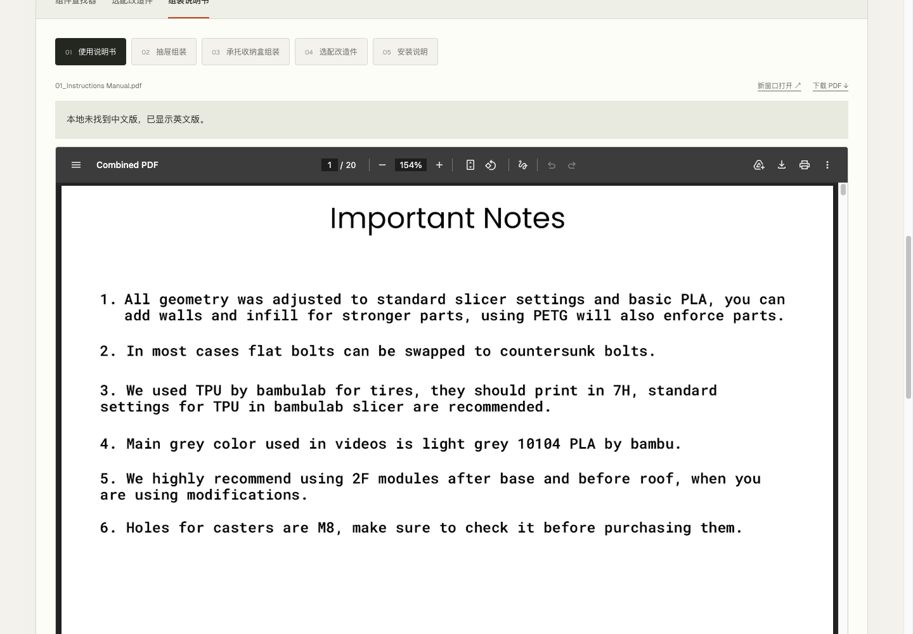

# Vault Workbench

**Vault 组装工作台：选择本地文件夹，查找组件、预览模型、阅读说明书。**

An unofficial browser-based workspace for USSA VAULT. Find parts, preview local STL models, and read assembly manuals—no server required.

面向 USSA VAULT 模块化收纳系统的非官方辅助工具。双击打开网页，选择已经解压的 Vault 资源文件夹，即可使用。无需安装应用、启动服务或上传模型文件。



*连接一次本地 Vault，即可查看资源数量，并按配置查找所需组件。截图中的数量来自演示资源包。*

## 功能

- **组件查找**：按宽度、深度、层高等配置，查找抽屉、承托收纳盒和选配改造件，查看配件数量与组装提示。
- **STL 预览**：在浏览器内旋转、缩放和平移模型，查看尺寸与三角面数量；大体积二进制 STL 使用 Worker 分块解析。
- **说明书阅读**：自动关联本地 PDF，支持页面内阅读、新窗口打开和下载。
- **中英文切换**：界面支持中英文；每份说明书独立选择可用语言，缺少中文版时自动显示英文版。
- **资源状态提示**：显示识别数量、缺失文件和路径冲突，支持更换文件夹、重新选择扫描及断开连接。
- **保存副本**：将已关联的 STL 或 PDF 另存为副本，原文件保持不变。
- **本地离线使用**：运行资源随项目提供，模型和说明书在本机读取。

## 界面预览

### STL 立体预览

直接读取本地 STL，旋转查看结构、切换视角，并查看模型尺寸和三角面数量。



### 说明书自动回退英文

中文界面下，如果本地只有英文说明书，会自动展示英文版，并给出明确提示。



## 快速开始

1. 下载本项目并解压，保留 `index.html` 和完整的 `assets/` 文件夹。
2. 准备已经解压的 Vault STL、PDF 和配图资源。
3. 使用浏览器打开 `index.html`，进入工作台。
4. 点击「选择 Vault 文件夹」，选择包含组件目录和说明书的资源文件夹，并确认浏览器的文件选择提示。
5. 在「组件查找器」「选配改造件」或「组装说明书」中使用相应功能。

默认界面为英文，可点击页面右上角「中文」切换语言。第一次选择目录时，英文按钮名称为 **Choose Vault folder**。

**日常使用不需要 Node.js、Python、命令行或启动脚本。刷新或重新打开页面后，需要再次选择文件夹。**

## 文件如何摆放

网页运行文件保持以下结构：

```text
vault-workbench/
├── index.html
└── assets/
    ├── vendor/
    ├── vault-resources.js
    ├── vault-connection.js
    ├── stl-preview.js
    └── 其他随项目提供的脚本、字体和图片
```

Vault 资源文件夹可以放在其他位置。下面是包含英文说明书的典型结构：

```text
My Vault/
├── 01. DRAWERS/
├── 02. SUSTAINERS/
├── 03. MODIFICATIONS/
├── 01_Instructions Manual.pdf
├── 02_Drawer Assembly.pdf
├── 03_Sustainers Assembly.pdf
├── 04_Modifications.pdf
└── 05_Mounting Instructions.pdf
```

外层文件夹可以改名，例如 `My Vault`；请保留资源包内部的组件目录结构和文件名。部分文件缺失不会阻止其他资源使用，对应位置会显示提示。

如果同一上级目录中有多份 Vault，请选择其中一份，不要同时导入多份资源包。资源更新后，点击「重新选择扫描」，再次选择同一文件夹即可更新索引。

## 说明书语言规则

| 当前界面语言 | 本地文件情况 | 显示结果 |
| --- | --- | --- |
| 中文 | 有中文版 | 中文版 |
| 中文 | 无中文版，有英文版 | 英文版，并显示回退提示 |
| 英文 | 有英文版 | 英文版 |
| 英文 | 无英文版，有中文版 | 中文版，并显示回退提示 |
| 任意 | 两种语言都没有 | 显示未找到说明书的提示 |

每份说明书单独判断；例如总说明书可以显示英文，抽屉组装说明书仍显示中文。下载按钮始终对应实际展示的文件。

目前支持的说明书文件名：

| 说明书 | 英文文件名 | 中文文件名（可选） |
| --- | --- | --- |
| 使用说明书 | `01_Instructions Manual.pdf` | `01_使用说明书_中文版.pdf` |
| 抽屉组装 | `02_Drawer Assembly.pdf` | `02_抽屉组装_中文版.pdf` |
| 承托收纳盒组装 | `03_Sustainers Assembly.pdf` | `03_承托收纳盒组装_中文版.pdf` |
| 选配改造件 | `04_Modifications.pdf` | `04_选配改造件_中文版.pdf` |
| 安装说明 | `05_Mounting Instructions.pdf` | `05_安装说明_中文版.pdf` |

从组件提示跳转到指定页时，如果发生语言回退，由于跨语言页码映射尚未核对，会打开文档首页并提示。项目不会自动翻译或生成中文 PDF。

## 本地文件与隐私

- 只有用户主动选择的文件夹才会进入资源索引。
- 选择目录时建立文件索引，点击预览时才解析对应 STL；PDF 在进入说明书页时加载。
- 所选模型和文档不会上传到服务器，也不会复制整个资源包到浏览器持久存储。
- 更换文件夹或断开连接时，会释放旧的资源 URL，并清理旧模型预览。
- 「保存副本」使用浏览器下载功能，不覆盖资源包内的原文件。

## 浏览器与使用限制

当前已在桌面 Chrome 的本地 `file://` 模式完成验证，包括目录选择、STL 预览、PDF 阅读和文件下载。其他浏览器尚未完成同等验证。

- 模型预览需要浏览器能够启用 WebGL 2。
- PDF 展示依赖浏览器的 PDF 查看能力；内嵌显示不可用时，可以尝试新窗口打开或下载阅读。
- 浏览器不能直接替本工具在 Finder 或资源管理器中选中原文件。页面显示相对路径，并提供保存副本操作。
- 当前不自动监听磁盘文件变化；更新资源后需重新选择扫描。
- 组件关联依赖内置目录和配置规则，不保证识别任意改名或未知版本的资源包。
- 二进制 STL 预览上限为 1,200 万三角面；实际可预览规模还取决于设备内存和图形能力。
- STL 不包含单位元数据，页面中的尺寸按毫米解释。

## 开发与测试

项目使用原生 HTML、CSS 和 JavaScript，模型渲染基于 Three.js，解析在 Web Worker 中进行。已打包的预览引擎位于 `assets/vendor/`，普通使用无需安装依赖或重新构建。

| 文件或目录 | 用途 |
| --- | --- |
| `index.html` | 页面布局、配置交互、语言切换和说明书展示 |
| `assets/vault-resources.js` | 本地资源索引、路径匹配、说明书语言回退和资源 URL 管理 |
| `assets/vault-connection.js` | 文件夹选择与连接状态 |
| `assets/local-files.js` | 文件可用状态与保存副本 |
| `assets/stl-preview.js` | 3D 预览交互与渲染 |
| `assets/stl-worker.js` | STL 解析源代码 |
| `assets/vendor/` | 已打包的浏览器依赖 |
| `scripts/` | 目录生成、预览引擎构建及保留的本地服务工具 |
| `tests/` | 资源匹配、组件规则和 STL 解析测试 |

在提供全局 `File`、`Blob` 和 `fetch` 的 Node.js 环境中，可运行不依赖原始资源包的核心测试：

```bash
node --test tests/vault-resources.test.cjs tests/stl-preview.test.cjs
```

完整组件目录测试还需要将与内置目录对应的三个原始组件文件夹放在项目根目录：

```bash
node --test tests/*.test.cjs
```

修改 `assets/stl-worker.js` 后，需要按照 `scripts/build-stl-vendor.cjs` 中的构建说明重新生成预览引擎；浏览器实际运行的是打包版本。

## 发布仓库

网页运行所需文件为 `index.html` 和完整的 `assets/`。开发仓库还可以包含 `scripts/`、`tests/` 和文档。

README 的界面截图位于 `docs/screenshots/`，上传仓库时请一并保留，以便 GitHub 正常显示配图。

原始 STL、PDF 和三个组件资源目录由使用者在本地准备，不需要随网页代码上传至 GitHub。仅下载网页代码的使用者，也不需要获取资源包就能运行上面的核心测试。

## 来源

本项目为非官方辅助工具，与 USSA Design 无隶属关系。VAULT 产品、模型、说明书及相关产品图片来源于 USSA Design；产品信息请参阅 [USSA Design 的 VAULT 页面](https://www.ussadesign.com/pages/vault)。

项目随附的第三方许可说明包括 [Three.js](assets/vendor/three-LICENSE.txt) 和 [Geist 字体](assets/geist-LICENSE.txt)。当前项目尚未提供独立的项目代码许可证，不代表第三方资源被重新授权。
