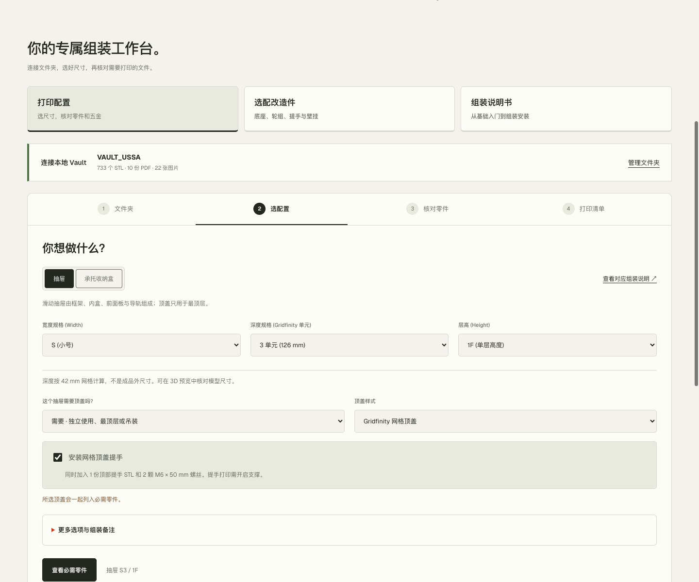
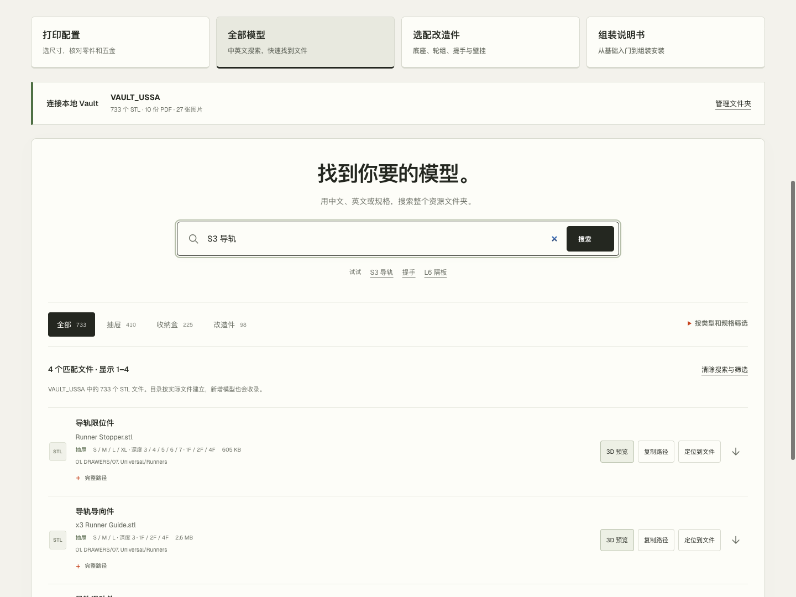
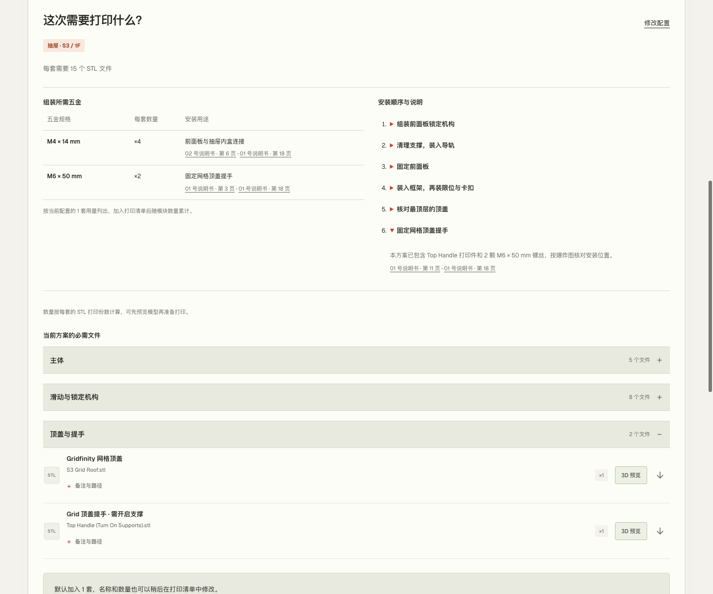
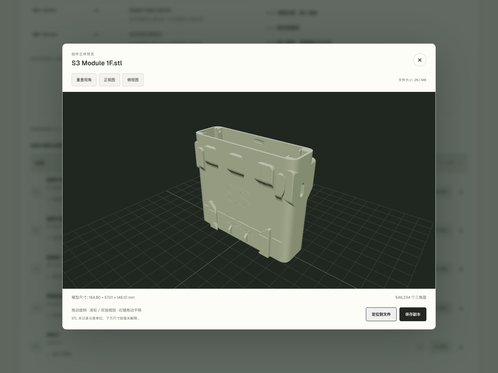
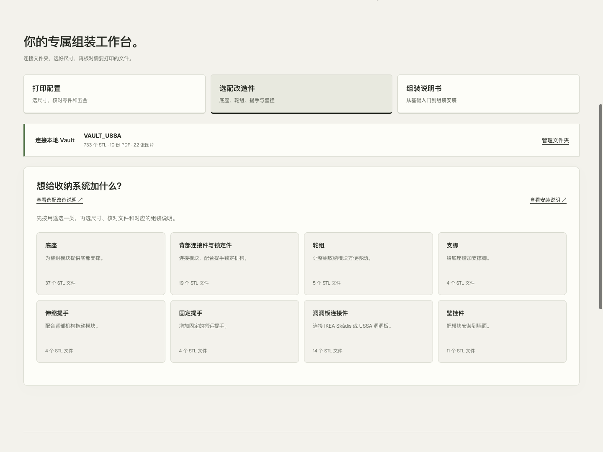
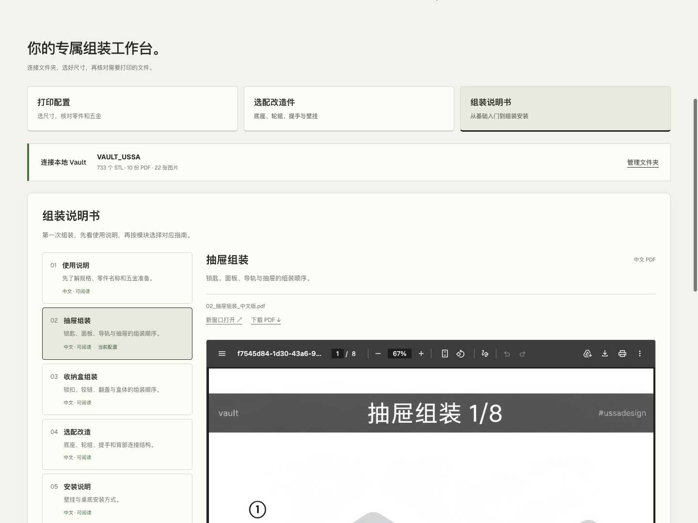
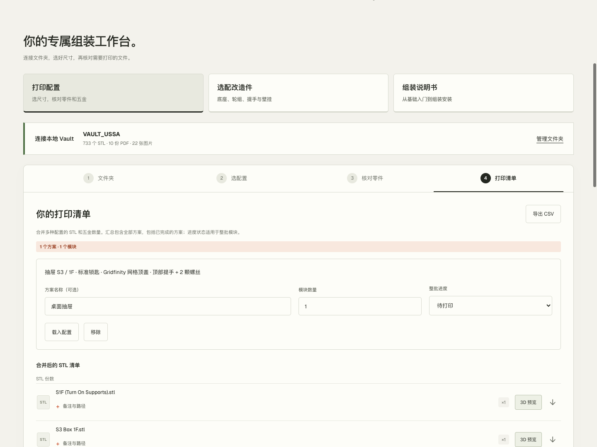

# VaultForge (formerly Vault-Workbench)

> **Precision 3D Configurator & Hardware Sourcing BOM for VAULT Modular Storage System**
> 
> 🌐 **在线网页版（免安装直接运行）**：[https://HairuoLiu.github.io/VaultForge/](https://HairuoLiu.github.io/VaultForge/)

**简体中文** | [English](README.en.md)

VaultForge 是针对 USSA VAULT 3D 打印模块化收纳柜系统的专业级配置与硬件供应链管理工作台。支持在浏览器中实时选型、三维预览、自动计算螺栓总数并**一键导出标准 A4 采购备料清单 (PDF)**。

原生 HTML / CSS / JavaScript 架构，零构建、零依赖。STL、说明书索引与打印清单全部在本地安全处理。



## 核心特性

- 🖨️ **一键导出五金采购清单 (PDF)**：支持单件配置及批量方案导出，自动汇总 M4/M6 螺丝总数，提供多伦多/全球最优惠采购建议与沉头/外六角防坑指南。
- 📦 **完整规格覆盖**：支持 S/M/L/XL 抽屉系列（1F~4F）、Sustainer 工具箱（分体盖、Gridfinity 底板）、移动推车底盘改造（轴承、光轴、拉杆）。
- 🔍 **双语混合即时检索**：733+ 个官方模型，支持中文/英文任意搜索，即点即预览。
- 🔒 **100% 隐私安全**：基于浏览器 File System Access API 本地读取，模型无需上传云端。

## 快速开始

1. 下载并解压本仓库，保留 `index.html`、`assets/` 和 `scripts/` 的相对位置。
2. 用桌面 Chrome 打开 `index.html`，页面右上角可切换中英文。
3. 点击 **选择 Vault 文件夹**，选中已解压的资源包根目录。
4. 按 **文件夹 → 选配置 → 核对零件 → 打印清单** 操作。没有资源包时，也可以先浏览规格。

只想找某个文件？连接文件夹后，打开 **全部模型**，输入 `S3 导轨`、`handle` 或 `L6 隔板`，即可预览模型、复制路径或保存副本。中文和英文可以混合搜索，无需切换界面语言。

资源目录示例（保留原包的目录和文件名）：

```text
My Vault/
├── 01. DRAWERS/
├── 02. SUSTAINERS/
├── 03. MODIFICATIONS/
├── 01_Instructions Manual.pdf
└── …其他说明书与图片
```

### 使用本地启动脚本

需要在全部模型列表或 3D 预览中 **定位到原始文件** 时，安装 Python 3.8+，再运行对应脚本：

| 系统 | 启动方式 |
| --- | --- |
| macOS | 双击 `启动预览.command` |
| Windows | 双击 `启动预览.bat` |
| 终端 | `python3 scripts/preview-server.py` |

默认地址为 `http://127.0.0.1:8765/index.html`。资源包放在项目目录或上一级；其他位置可指定路径，并在页面选择同一个文件夹：

```bash
python3 scripts/preview-server.py --resource-root "/path/to/Vault"
```

「定位到文件」会在 Finder / 文件资源管理器中选中原始 STL。直接打开 HTML 时不显示此按钮。

## 功能一览

| 功能 | 可以做什么 |
| --- | --- |
| 分步配置 | 选择抽屉或收纳盒，设置尺寸、顶盖、内部布局和适用的选装方案 |
| 全部模型 | 索引实际文件夹中的全部 STL；支持中英文模糊搜索、用途与规格筛选、分页、复制路径和单独预览 |
| 分类核对 | 按主体、机构、顶盖、内部收纳分组，默认展开；显示文件数、打印份数和备注 |
| 五金与安装 | 列出规格、每套用量、用途和说明书页码；网格顶盖提手联动加入 2 颗 M6 × 50 mm 螺丝 |
| 3D 预览 | 旋转、缩放、核对模型尺寸、保存副本；脚本模式支持定位原文件 |
| 配件与改造 | 查看适配的底板、隔板和替代件；按 8 类用途浏览底座、轮组、提手等改造件 |
| 说明书 | 按用途选择 5 本指南，查看本地可用状态，跳转相关安装页面，缺少当前语言时自动回退 |
| 打印清单 | 保存多个方案，按套数汇总 STL 和五金，填写隔板用量，记录进度并导出 CSV |

## 界面预览

截图来自当前版本的中文界面，点击可查看原图。



| 分类核对零件与五金 | 本地 STL 预览 |
| --- | --- |
|  |  |

| 按用途选择改造件 | 说明书与安装指南 |
| --- | --- |
|  |  |

<details>
<summary>查看打印清单截图</summary>



</details>

## 使用说明

- **搜索范围**：全部模型以实际文件夹为准，新加入或暂未分类的 STL 也会显示，同名文件按完整路径区分。尺寸筛选使用已知适配关系；规格未确认的文件可通过名称或路径搜索。搜索与筛选会随工作区保存，文件有变化时需重新扫描。
- **数量怎么算**：文件数量与打印份数分开显示。`×2` 表示打印两份 STL；文件内自带的成对零件不再翻倍。隔板等按布局决定的用量需要手动填写，不需要的填 `0`，填齐后才能导出。
- **选装如何计入**：「使用此方案」更新当前配置，之后需点击「加入打印清单」。浏览配件不会自动加入，已保存方案也不会随当前选择被改写。
- **五金的范围**：抽屉和收纳盒的五金随方案套数累计；改造件的五金按轮组、支脚等单独展示参考。原说明未明确的安装用量标为待核对，并保留在对应方案和 CSV 提示中。
- **保存与恢复**：浏览器存储可用时，语言、配置和清单保存在当前浏览器。支持目录访问的浏览器可记住文件夹，必要时点击「重新连接」授权；不支持时需重新选择。资源更新后点击「重新扫描」，主动断开会清除目录记忆。
- **数据边界**：不同浏览器、打开方式或端口使用不同的浏览器存储；清除浏览器数据可能丢失清单。建议导出 CSV 留存，目前不支持 CSV 导入。「保存副本」不会覆盖原文件。

<details>
<summary>浏览器、端口与文件问题</summary>

- 已验证桌面 Chrome；其他浏览器尚未完成同等验证。3D 预览需要 WebGL 2，尺寸按毫米解释。
- PDF 无法内嵌显示时，可以新窗口打开或下载。
- 一次选择一份资源包。缺失或重名冲突的文件会显示提示，请保留原包结构和文件名。
- 端口被占用时，使用 `--port 其他端口`。旧端口下的清单不会自动迁移，可用 `--port 原端口` 回到原地址查看或导出。
- 更新工作台代码后刷新页面；如果旧脚本仍在运行，先关闭旧服务再重新启动。

</details>

## 开发与测试

项目无需构建即可运行。3D 预览使用 Three.js 和 Web Worker；测试需要支持全局 `File`、`Blob`、`fetch` 的 Node.js，以及 Python 3。

在仓库根目录运行：

```bash
node --test tests/*.test.cjs
python3 -m unittest discover -s tests -p 'test_*.py'
```

安装 `agent-browser` 后，可运行浏览器回归（使用隔离的临时浏览器配置）：

```bash
node tests/assembly-readiness.browser.cjs /path/to/agent-browser
```

其他场景见 [tests/](tests/)：模型搜索、配置引导、配件、说明书、清单编辑和文件夹恢复。真实资源校验自动查找当前目录或上一级，也可设置 `VAULT_RESOURCE_ROOT`；未提供资源包时跳过对应校验。

修改 `assets/stl-worker.js` 后，按 [预览引擎构建脚本](scripts/build-stl-vendor.cjs) 中的说明重新打包。反馈问题时，请附上浏览器、打开方式、配置规格和复现步骤。

## 来源与许可

本项目与 USSA Design 无隶属关系。VAULT 模型、说明书及产品图片来源于 [USSA Design](https://www.ussadesign.com/pages/vault)，原始 STL 和 PDF 不随仓库分发，截图中的原始设计内容归其权利人所有。

第三方许可：[Three.js](assets/vendor/three-LICENSE.txt) · [Geist](assets/geist-LICENSE.txt)。项目代码暂未提供独立许可证。
